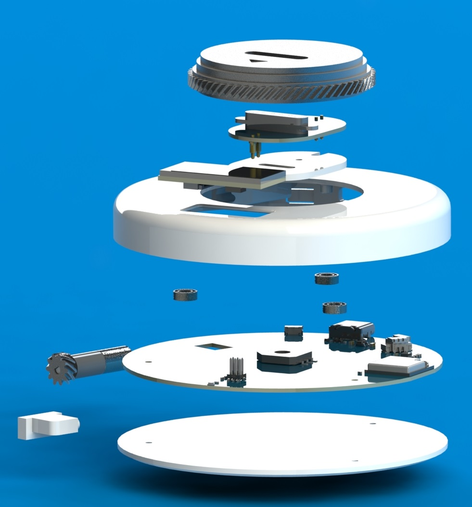

# ESP-EchoEar 配套旋转底座示例

本示例为 ESP-EchoEar 配套旋转底座固件，主要包括如下功能：

1. UART 接收并解析来自 ESP-EchoEar 的旋转指令
2. 通过 PID 控制转台旋转至指定角度
3. ESP-NOW 控制转台左右旋转
4. 0.96 寸 LCD 显示
5. 底座旋转功能测试

## 硬件说明

* 主控：ESP32-C3-MINI-IU
* 转台驱动电机选用：[微型行星减速电机](https://item.taobao.com/item.htm?abbucket=3&detail_redpacket_pop=true&id=666803305464&ltk2=1747824612318gomnf4m0yzpe0c50bcnr&ns=1&priceTId=2150405a17478245822955964e1bf6&query=%E7%A9%BA%E5%BF%83%E6%9D%AF%E5%87%8F%E9%80%9F%E7%94%B5%E6%9C%BA&skuId=4977776422652&spm=a21n57.1.hoverItem.4&utparam=%7B%22aplus_abtest%22%3A%22ca6e52a21698dc69d79fa8a00a24a116%22%7D&xxc=taobaoSearch)，选择`242转速`的。
* 转台角度传感器使用[SV01A103AEA01R00 旋转角度位置传感器](https://detail.tmall.com/item.htm?abbucket=3&detail_redpacket_pop=true&id=598862271182&ltk2=1749697948729h3g62nkl3oil30f4a7dijs&ns=1&priceTId=undefined&query=SV01A103AEA01R00&skuId=4497399115414&spm=a21n57.1.hoverItem.1&utparam=%7B%22aplus_abtest%22%3A%22e4a0d47647c5904332cf40c904f88bde%22%7D&xxc=taobaoSearch)
* 屏幕选用[0.96 寸 LCD](https://item.taobao.com/item.htm?abbucket=3&detail_redpacket_pop=true&id=611057315553&ltk2=1749699933583y6mwnjx98r6vgc4p3ss7v&ns=1&priceTId=undefined&query=0.96%E5%AF%B8%20LCD&skuId=4781880518663&spm=a21n57.1.hoverItem.7&utparam=%7B%22aplus_abtest%22%3A%222383c8f94d4fe79c6a2b126a532a91fc%22%7D&xxc=taobaoSearch)

## 软件功能说明

### ESP-EchoEar 主体与底座串口通信协议说明

旋转底座是被控对象，它需要接收 ESP-EchoEar 本体发送的角度（具体多少度由本体声源识别后得出）控制命令才能知道自己要转到哪个位置。ESP-EchoEar 主体与底座串口通信协议说明如下：

* 数据帧格式

| 字节索引 | 字段名 | 长度 | 描述 |
|---------|--------|------|------|
| 0-1 | 帧头 | 2B | 固定为 0xAA 0x55 |
| 2-3 | 数据长度 | 2B | 指令码 + 数据字段总长度 |
| 4 | 命令码 | 1B | 0x01 = 角度控制；0x02 = RGB控制 |
| 5~n | 数据字段 | nB | 根据命令不同，长度/格式不同 |
| 最后一位 | 校验和 | 1B | 命令码 + 所有数据字段的字节求和 |

* 命令对照表

| 控制类型 | 示例数据帧 | 数据长度字段 | 命令码 | 数据字段 | 校验和 | 含义说明 |
|---------|------------|--------------|--------|----------|--------|----------|
| 角度控制 | AA 55 00 03 01 01 2C 2E | 00 03 | 0x01 | 01 2C（角度：十进制 300） | 0x2E | 0x01 + 0x01 + 0x2C = 0x2E |

如若接收到正确的角度控制指令，会打印出如下日志：
```
rotating_base: === Base Angle Control Command ===
rotating_base: Frame header: 0xAA 0x55
rotating_base: Data length: 3
rotating_base: Command: 0x01
rotating_base: Angle value: 300
rotating_base: Checksum: 0x2E (calculated: 0x2E)
rotating_base: Checksum verification passed
```

### 底座转台角度获取

转台通过结构与一个 360 度旋转电位器（[SV01A103AEA01R00 旋转角度位置传感器](https://detail.tmall.com/item.htm?abbucket=3&detail_redpacket_pop=true&id=598862271182&ltk2=1749697948729h3g62nkl3oil30f4a7dijs&ns=1&priceTId=undefined&query=SV01A103AEA01R00&skuId=4497399115414&spm=a21n57.1.hoverItem.1&utparam=%7B%22aplus_abtest%22%3A%22e4a0d47647c5904332cf40c904f88bde%22%7D&xxc=taobaoSearch)）进行绑定，利用电阻串联分压原理，通过 ADC 读取电位器中间端子电压即可反馈其角度。

### 底座旋转功能测试

为方便在组装完一套底座后验证其转台旋转是否正常，本固件添加了转台旋转测试程序，通过**单击 Boot 键触发**，单击后转台将从中间位置向左旋转 90 度，再向右旋转 90 度，最后回到中间位置，如若转台旋转现象与预设描述一致，且旋转流畅，则判定转台旋转功能正常。

## 3D 结构设计说明

旋转底座的 3D 结构爆炸视图如下：

<p align="center">
  
</p>
电机通过螺旋齿轮传动对转台进行驱动。

## ESP-IDF 要求

- 此示例支持 IDF release/v5.1 及更高的分支。默认情况下，它在 IDF release/v5.4 上运行。
- 请按照 [ESP-IDF 编程指南](https://docs.espressif.com/projects/esp-idf/zh_CN/latest/esp32/get-started/index.html) 设置开发环境。**我们强烈建议**您 [构建第一个项目](https://docs.espressif.com/projects/esp-idf/zh_CN/latest/esp32/get-started/index.html#build-your-first-project)，以熟悉 ESP-IDF 并确保环境设置正确。

## 如何使用示例

### 构建和烧录示例

构建项目并将其烧录到 ESP-EchoEar 配套旋转底座核心板，然后运行监视工具查看串行输出（将 `PORT` 替换为您的开发板串口名称）：

```c
idf.py -p PORT flash monitor
```

要退出串行监视器，请输入 ``Ctrl-]``。

完整的配置和使用 ESP-IDF 构建项目的步骤，请参见 [ESP-IDF 入门指南](https://docs.espressif.com/projects/esp-idf/zh_CN/latest/get-started/index.html)。

### 示例输出

- 完整日志如下：

```
I (24) boot: ESP-IDF v5.4.1-855-g46909c50486 2nd stage bootloader
I (24) boot: compile time Jun 11 2025 17:45:34
I (25) boot: chip revision: v1.1
I (26) boot: efuse block revision: v1.3
I (29) qio_mode: Enabling default flash chip QIO
I (34) boot.esp32c3: SPI Speed      : 80MHz
I (38) boot.esp32c3: SPI Mode       : QIO
I (41) boot.esp32c3: SPI Flash Size : 4MB
I (45) boot: Enabling RNG early entropy source...
I (50) boot: Partition Table:
I (52) boot: ## Label            Usage          Type ST Offset   Length
I (59) boot:  0 nvs              WiFi data        01 02 00009000 00006000
I (65) boot:  1 phy_init         RF data          01 01 0000f000 00001000
I (72) boot:  2 factory          factory app      00 00 00010000 00200000
I (78) boot: End of partition table
I (81) esp_image: segment 0: paddr=00010020 vaddr=3c0c0020 size=22658h (140888) map
I (109) esp_image: segment 1: paddr=00032680 vaddr=3fca5c00 size=02f78h ( 12152) load
I (111) esp_image: segment 2: paddr=00035600 vaddr=40380000 size=0aa18h ( 43544) load
I (120) esp_image: segment 3: paddr=00040020 vaddr=42000020 size=bb3e8h (766952) map
I (227) esp_image: segment 4: paddr=000fb410 vaddr=4038aa18 size=1b154h (110932) load
I (246) esp_image: segment 5: paddr=0011656c vaddr=50000000 size=0001ch (    28) load
I (256) boot: Loaded app from partition at offset 0x10000
I (257) boot: Disabling RNG early entropy source...
I (266) cpu_start: Unicore app
I (274) cpu_start: Pro cpu start user code
I (275) cpu_start: cpu freq: 160000000 Hz
I (275) app_init: Application information:
I (275) app_init: Project name:     rotating_base
I (279) app_init: App version:      1fd9acc-dirty
I (283) app_init: Compile time:     Jun 12 2025 15:37:27
I (288) app_init: ELF file SHA256:  46f277396...
I (293) app_init: ESP-IDF:          v5.4.1-855-g46909c50486
I (298) efuse_init: Min chip rev:     v0.3
I (302) efuse_init: Max chip rev:     v1.99 
I (306) efuse_init: Chip rev:         v1.1
I (310) heap_init: Initializing. RAM available for dynamic allocation:
I (316) heap_init: At 3FCACE00 len 00013200 (76 KiB): RAM
I (321) heap_init: At 3FCC0000 len 0001C710 (113 KiB): Retention RAM
I (327) heap_init: At 3FCDC710 len 0000294C (10 KiB): Retention RAM
I (333) heap_init: At 5000001C len 00001FCC (7 KiB): RTCRAM
I (339) spi_flash: detected chip: generic
I (342) spi_flash: flash io: qio
I (346) sleep_gpio: Configure to isolate all GPIO pins in sleep state
I (351) sleep_gpio: Enable automatic switching of GPIO sleep configuration
I (358) main_task: Started on CPU0
I (361) main_task: Calling app_main()
I (368) pp: pp rom version: 74f9620
I (368) net80211: net80211 rom version: 74f9620
I (373) wifi:wifi driver task: 3fcb6594, prio:23, stack:6656, core=0
I (379) wifi:wifi firmware version: bea31f3
I (381) wifi:wifi certification version: v7.0
I (385) wifi:config NVS flash: enabled
I (389) wifi:config nano formatting: disabled
I (393) wifi:Init data frame dynamic rx buffer num: 32
I (398) wifi:Init static rx mgmt buffer num: 5
I (402) wifi:Init management short buffer num: 32
I (406) wifi:Init dynamic tx buffer num: 32
I (410) wifi:Init static tx FG buffer num: 2
I (414) wifi:Init static rx buffer size: 1600
I (418) wifi:Init static rx buffer num: 10
I (422) wifi:Init dynamic rx buffer num: 32
I (426) wifi_init: rx ba win: 6
I (429) wifi_init: accept mbox: 6
I (432) wifi_init: tcpip mbox: 32
I (435) wifi_init: udp mbox: 6
I (438) wifi_init: tcp mbox: 6
I (441) wifi_init: tcp tx win: 5760
I (444) wifi_init: tcp rx win: 5760
I (447) wifi_init: tcp mss: 1440
I (450) wifi_init: WiFi IRAM OP enabled
I (453) wifi_init: WiFi RX IRAM OP enabled
I (458) wifi:Set ps type: 0, coexist: 0

I (461) phy_init: phy_version 1201,bae5dd99,Mar  3 2025,15:36:21
I (499) wifi:mode : sta (18:8b:0e:af:19:a8)
I (499) wifi:enable tsf
I (500) espnow: esp-now Version: 2.5.2
W (500) wifi:Haven't to connect to a suitable AP now!
I (502) ESPNOW: espnow [version: 2.0] init
I (506) espnow: mac: 18:8b:0e:af:19:a8, version: 2
I (510) espnow: Enable main task
I (513) espnow: main task entry
I (514) LVGL: Starting LVGL task
I (520) ili9341: LCD panel create success, version: 2.0.0
W (764) ili9341: The 3Ah command has been used and will be overwritten by external initialization sequence
W (764) ili9341: The 36h command has been used and will be overwritten by external initialization sequence
I (778) gpio: GPIO[2]| InputEn: 0| OutputEn: 1| OpenDrain: 0| Pullup: 0| Pulldown: 0| Intr:0 
I (780) button: IoT Button Version: 3.4.0
I (784) gpio: GPIO[9]| InputEn: 1| OutputEn: 0| OpenDrain: 0| Pullup: 1| Pulldown: 0| Intr:0 
I (792) button: IoT Button Version: 3.4.0
I (796) gpio: GPIO[9]| InputEn: 1| OutputEn: 0| OpenDrain: 0| Pullup: 1| Pulldown: 0| Intr:0 
I (804) gpio: GPIO[0]| InputEn: 0| OutputEn: 0| OpenDrain: 0| Pullup: 0| Pulldown: 0| Intr:0 
I (812) motor_ctrl: calibration scheme version is Curve Fitting
I (818) motor_ctrl: Calibration Success
I (821) gpio: GPIO[5]| InputEn: 0| OutputEn: 1| OpenDrain: 0| Pullup: 0| Pulldown: 0| Intr:0 
I (831) main_task: Returned from app_main()
I (131843) rotating_base: === Base Angle Control Command ===
I (131843) rotating_base: Frame header: 0xAA 0x55
I (131843) rotating_base: Data length: 3
I (131845) rotating_base: Command: 0x01
I (131848) rotating_base: Angle value: 300
I (131852) rotating_base: Checksum: 0x2E (calculated: 0x2E)
I (131858) rotating_base: Checksum verification passed
I (131881) motor_ctrl: Motor driver enabled
I (132382) motor_ctrl: Motor driver disabled
```

